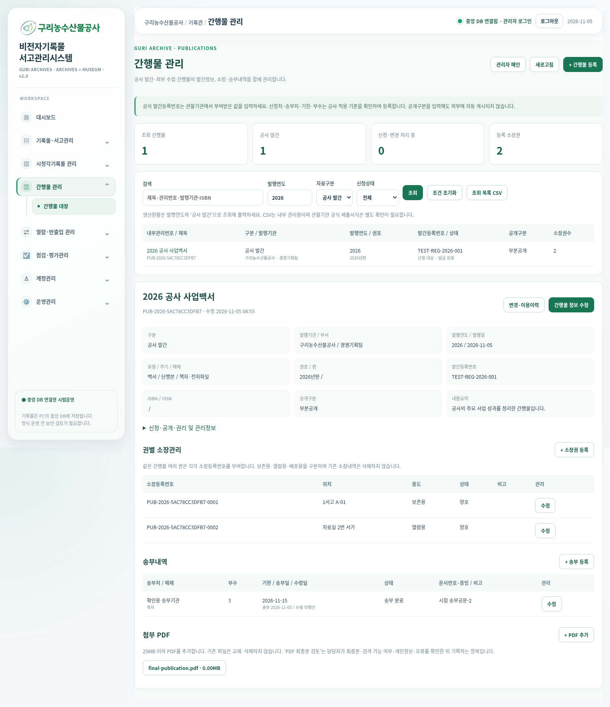

# GuriArchive 간행물 관리 · 2026.11.05

[간행물 관리 누적 패치 ZIP 다운로드](../GuriArchive_publications_patch_20261105.zip)

## 추가 메뉴

관리자 왼쪽 메뉴 **간행물 관리 → 간행물 대장**에서 이용합니다. 직접 경로는 `/manager#publications` 또는 `/publications`입니다. 기존 사진·신청·승인·중앙 반투명 워터마크 기능은 유지됩니다.

## 구현 기능

- 공사 발간 / 외부 수집 구분, 내부 관리번호 자동 부여
- 제목·저자·발행기관·부서·연도·발행일·유형·주기·매체·권호·판·ISBN·ISSN·쪽수·크기·내용요약 등록·수정·검색
- 공식 발간등록번호는 외부에서 부여받은 값을 직접 입력; 신청 대상·생략 판단 및 사유·신청상태·신청일·담당기관·공문번호·변경사유 관리
- 공개구분·법적 근거·사유·부분공개 범위·제한기간·저작물 이용동의·공공누리 및 권리 확인 내용 관리
- 권별 소장등록번호 자동 부여, 보존용·열람용·배포용 및 위치·상태 관리
- 송부처별 매체·부수·기한·송부일·수령일·공문·증빙 기록; 미송부 기한 경과 표시
- PDF 추가·관리자 열람. 기존 PDF를 교체하거나 삭제하지 않으며 새 파일로 누적 보관
- 담당자 PDF 최종본 검토 상태 기록: 최종본·텍스트 검색 가능 여부·개인정보·오류를 직접 확인한 뒤 입력하는 항목이며 자동 PDF 품질검사 결과가 아닙니다.
- 기존 일반기록물 관리번호 연계, 변경·이용이력 조회
- 연도·자료구분·신청상태·검색어 필터 및 조회 목록 CSV 출력. 공사 생산현황은 해당 발행연도와 ‘공사 발간’으로 조회합니다.
- 동시 수정 시 구버전 저장을 차단하여 다른 관리자의 변경을 덮어쓰지 않음

## 지침 반영 범위

제공된 **서울기록원 간행물 관리지침 v1.0(2025.1.15)**을 참고하여 관리 항목을 구성했습니다. 해당 지침은 서울시 및 관할기관의 절차를 포함하므로 구리농수산물공사에 서울시 신청처·송부처·기한·부수·번호 부여 방식을 일괄 강제하지 않았습니다. 공사 적용 관할기관의 기준을 확인해 입력하세요.

공식 발간등록번호 발급, 관할기관으로의 공문 발송·파일 송부는 자동 연계하지 않습니다. 신청·발급·송부 이력을 내부에서 관리하는 기능입니다. CSV도 내부 관리용 목록이며 관할기관의 공식 제출서식은 별도 확인이 필요합니다.

이번 메뉴는 관리자 간행물 관리용입니다. 공개구분이나 이용동의를 입력해도 직원·외부에 PDF가 자동 공개되지 않습니다. 일반 구입 도서의 대출·반납 기능은 포함하지 않습니다.

## 적용

1. 관리자 서버와 직원 서버를 모두 종료합니다.
2. 기존 설정·DB·미디어를 보관한 상태에서 ZIP 내용 전체를 실제 실행 중인 기존 `GuriArchive` 폴더 안에 덮어씁니다. `watermark_assets`도 함께 복사하세요.
3. 기존 방식으로 서버를 재시작합니다. 간행물용 새 테이블 4개가 추가됩니다. 기존 기록물·신청·계정·사진·PDF는 삭제하거나 초기화하지 않습니다.
4. 브라우저에서 Ctrl+F5로 새로고침한 뒤 **간행물 관리 → 간행물 대장**을 선택합니다.
5. 최초 등록은 간행물 제목·발행연도, 공사 발간물의 발행기관·부서 등을 입력합니다. 부분공개·비공개인 경우 근거와 사유도 입력해야 합니다.

초기설정·DB 초기화는 실행하지 마세요. ZIP에는 runtime, DB, 소장 PDF·사진, 가상환경, config.json을 포함하지 않았습니다. 원문 PDF는 기존 media_dir 아래 새 `publication_pdfs` 폴더에 저장됩니다.

## 검증

- 별도 임시 DB 테스트 50개 통과
- 실제 관리자 메뉴 iframe 안에서 등록·수정·필수 검증·소장권·송부내역·PDF 첨부/범위 열람·조건별 CSV·이력·모바일 화면 검증
- 직원용 서버와 관리자 서버의 직원 계정 모두 간행물 관리 경로 접근 차단; CSRF 확인
- 기존 사진 신청·선택 승인·중앙 반투명 워터마크·반려·일반기록물 신청 연계 브라우저 회귀검증
- 최초 업로드 소스에 누적 ZIP을 덮어쓴 별도 환경에서도 50개 테스트 통과
- 최초 첨부 DB를 임시 복사하여 반복 초기화한 뒤 기존 모든 행·값 보존 확인; 기존 runtime DB·PDF·사진 해시 불변 확인

## 화면 예시

아래는 실제 공사 발간물과 무관한 테스트 데이터입니다.

