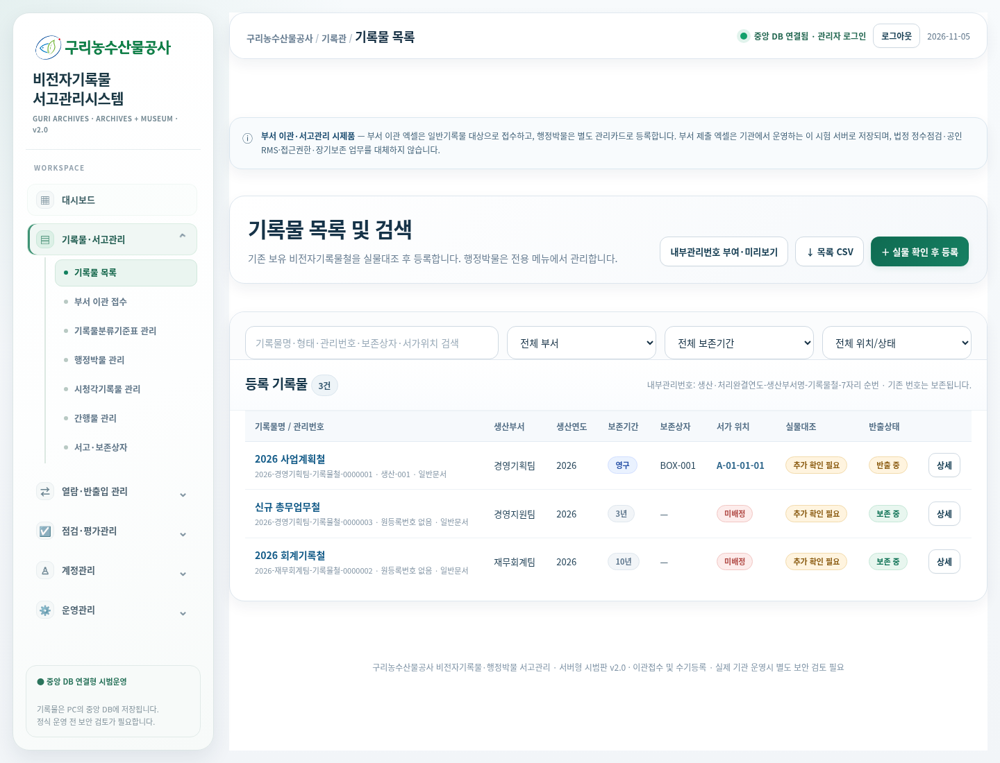

# 비전자기록물 내부관리번호 · 2026.11.05

[내부관리번호 기능 누적 패치 ZIP 다운로드](../GuriArchive_record_numbers_patch_20261105.zip)

## 확정한 표시 형식

**생산·처리완결연도-생산부서명-기록물철-7자리 일련번호**

- `2026-경영기획팀-기록물철-0000001`
- `2026-재무회계팀-기록물철-0000002`
- `2026-경영기획팀-기록물철-0000003`
- `2027-경영기획팀-기록물철-0000001`

같은 연도 전체에서 부서 구분 없이 순번을 이어갑니다. 부서명은 실제 입력한 한글 부서명을 사용합니다. 한번 부여한 번호는 제목·생산부서·연도·서고 위치를 수정해도 자동 변경하지 않습니다. 발급된 번호는 기존 자료가 백업 복원 등으로 현재 목록에서 빠져도 해당 DB의 번호대장에서 보존합니다.

## 신규 등록

실물 확인 후 수기 등록과 부서 이관 인수확정으로 새 비전자기록물철이 등록될 때 서버에서 자동 부여합니다. 저장 완료 후 목록에 새 번호가 표시됩니다. 생산·처리완결연도와 생산부서명은 번호 발급에 필요합니다.

기존 미부여 기록물을 먼저 적용하면 기존 자료부터 순번이 부여됩니다. 먼저 신규 등록하여 이미 발급된 번호가 있다면, 기존 자료는 그 다음 순번부터 부여됩니다. 적용 후 번호 순서를 다시 맞추거나 재사용하지 않습니다.

## 기존 기록물 적용

1. **기록물·서고관리 → 기록물 목록**으로 이동합니다.
2. **내부관리번호 부여·미리보기** 버튼을 누릅니다.
3. 종전 번호와 부여할 번호를 비교합니다. 미리보기만으로 DB의 번호나 기록물은 변경되지 않습니다.
4. **미리보기 N건 번호 부여**를 누르면 적용됩니다.

생산연도·부서명이 누락되거나 형식이 맞지 않는 자료는 이번 적용에서 제외하고 사유를 표시합니다. 해당 정보를 확인·수정한 뒤 다시 미리보기하면 됩니다. 이미 번호를 받은 자료는 다시 발급하지 않습니다. 한 번에 최대 1,000건을 적용하며 나머지는 다음 미리보기로 이어서 처리할 수 있습니다.

다른 창에서 자료가 수정되거나 번호가 먼저 발급되면 기존 미리보기의 적용을 중단하고 다시 확인하도록 안내합니다.

## 기존 연결 보존

`GR-0001` 같은 시스템 ID는 변경하지 않고 표시용 관리번호를 별도 대장에 저장합니다. 따라서 다음 연결을 그대로 유지합니다.

- 기존 PDF·원등록번호·사진 연계·간행물 연계
- 온라인 열람신청·승인·기간 권한
- 실물 반출입·정수 및 상태점검·평가·폐기 이력

기존 번호는 상세정보의 **종전 관리번호 / 시스템 ID**에 남고 기존·신규 번호 모두 검색할 수 있습니다. 목록·상세·직원 검색·신청목록·반출입·점검 대장·CSV 및 보존상자 라벨·이관 인수확인서에는 새 번호를 연결했습니다. 기록물 목록 CSV에는 종전 번호도 별도 열로 제공합니다.

공식 기록물 등록번호나 생산 당시 원등록번호를 대체하거나 수정하는 기능은 아닙니다.

## 설치

1. 관리자·직원 서버를 모두 종료합니다.
2. 기존 DB와 media_dir 및 설정을 보관하고, ZIP 내용 전체를 실제 실행 중인 기존 `GuriArchive` 폴더 안에 덮어씁니다. `watermark_assets`도 함께 복사하세요.
3. 기존 방식으로 서버를 재시작합니다. 번호 대장·연도별 순번 테이블 2개가 추가됩니다. 기존 기록물에는 자동 일괄 번호를 부여하지 않습니다.
4. Ctrl+F5로 새로고침하고 기존 자료는 위 미리보기에서 적용합니다.

이 ZIP은 간행물·중앙 반투명 워터마크·관리자 메뉴 재배치까지 포함한 누적 패치입니다. runtime·DB·PDF·소장 사진·config.json·가상환경은 포함하지 않습니다. 초기설정이나 데이터 초기화를 실행하지 마세요.

번호 대장과 사용이력은 DB에 저장되므로 **DB 전체와 미디어를 함께 백업**하세요. JSON 백업은 첨부파일과 전체 번호 대장을 대체하지 않습니다. JSON에 포함된 표시 번호를 복원할 때는 충돌을 검사하며, 기존 DB에 예약된 번호를 덮어쓰지 않습니다.

## 검증

- 별도 임시 DB 테스트 65개 통과
- 한글 부서명, 연도 전체 순번·연도 전환, 번호 고정, 중복·동시 발급, 미리보기 무변경, 누락 자료 제외, 복원 충돌·번호 재사용 방지 검증
- 브라우저에서 기존 번호 적용·신규 수기 등록 자동번호·한글 검색·상세·CSV·라벨·직원 열람·CSRF 검증
- 간행물과 사진 신청·승인·중앙 워터마크·일반기록물 신청 흐름 회귀검증
- 최초 첨부 소스에 누적 ZIP을 덮어쓴 별도 환경에서도 65개 테스트 통과
- 최초 DB를 임시 복사하여 초기화를 반복한 뒤 기존 값 보존 확인; 기존 runtime DB·PDF·사진 해시 불변 확인

아래 화면은 실제 공사 기록물과 무관한 테스트 데이터입니다.

