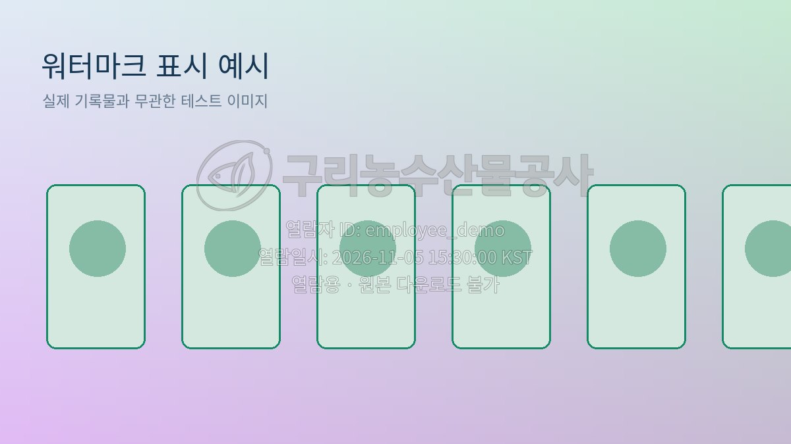

# 사진 중앙 반투명 워터마크 · 2026.11.05-v3-center

[중앙 워터마크 누적 패치 ZIP 다운로드](../GuriArchive_center_watermark_20261105.zip)

기존 사진 하단의 불투명 정보 띠를 제거하고, 사진 중앙에 기관 로고와 열람정보를 반투명으로 직접 합성하도록 수정했습니다.

- 기관 로고 + 로그인한 열람자 ID + 한국시간 열람일시 + `열람용 · 원본 다운로드 불가`
- 로고 약 29%, 글자 약 38% 불투명도와 얇은 반투명 검정 윤곽선으로 밝고 어두운 사진 모두 대응
- 원본을 수정하지 않고 요청 시 메모리에서 열람용 응답 이미지만 생성
- 확대 열람 및 직원·관리자 썸네일에 적용, 관리자 보존용 원본 다운로드는 원본 그대로 유지
- 사진의 가로세로 비율 유지. 일반 이미지에는 여백이나 하단 띠를 추가하지 않음. 작은 사진은 가독성을 위해 비율을 유지한 채 확대하며 열람용 사진 크기는 최대 1800×1800
- 기존 공개·신청자·허용 사진·열람기간 검사와 사용이력 기록 유지

## 적용

1. 관리자 서버와 직원 서버를 모두 종료합니다.
2. ZIP 내용 전체를 실제 실행 중인 기존 `GuriArchive` 폴더 안에 덮어씁니다. `watermark_assets`도 함께 복사하세요.
3. 두 서버를 재시작하고 브라우저에서 Ctrl+F5로 새로고침합니다.
4. 사진 화면의 상태가 `워터마크 적용 중 · 2026.11.05-v3-center`인지 확인합니다.
5. 직원 사진 확대 화면 또는 관리자 `워터마크 확대 열람`에서 확인합니다. 관리자 원본 다운로드에는 워터마크가 없습니다.

이전 신청·승인·워터마크 표시 수정을 포함하는 누적 패치입니다. ZIP에는 runtime·DB·PDF·소장사진·가상환경을 포함하지 않았으며 기존 데이터를 초기화하지 않습니다.

## 검증

- 별도 임시 DB 회귀검사 37개 통과
- 밝고 어두운 테스트 사진에서 중앙 픽셀이 반투명으로 변경되고 모서리는 보존되는지 확인
- 사진 비율 유지 및 하단 정보 띠 제거 확인
- 실제 직원·관리자 서버와 브라우저에서 적용 버전·개인화 이미지·신청·승인·열람·반려·일반기록물 연계 검증
- 최초 첨부 소스에 ZIP을 덮어쓴 환경에서도 37개 테스트 통과
- 기존 DB·PDF·사진의 해시 불변 확인

## 미리보기

아래는 실제 소장기록물과 무관한 테스트 이미지이며 ID와 시각은 설명용입니다.

[밝은 배경 예시](light-center.jpg) · [어두운 배경 예시](dark-center.jpg)
