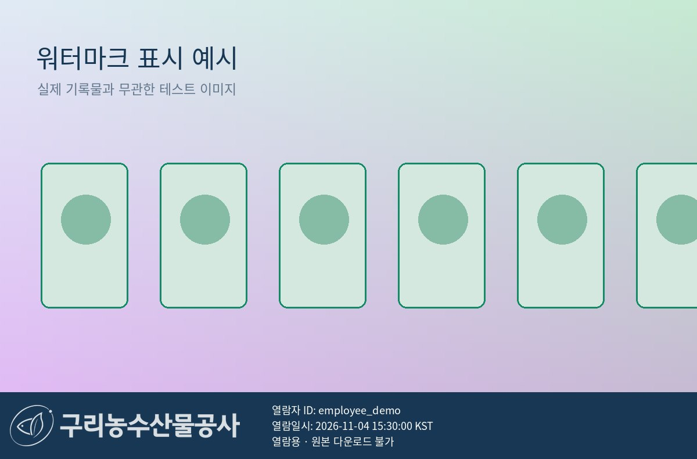

# GuriArchive 사진 열람 워터마크 패치

[패치 ZIP 다운로드](../GuriArchive_watermark_patch_20261104.zip)

2026.11.04 첨부 소스를 기준으로 한 **누적 패치**입니다. 앞서 개발한 시청각 열람신청·승인 기능과 이번 워터마크 기능을 함께 포함합니다.

## 표시 내용

- 사진 아래 정보 띠에 기관 로고, 로그인한 열람자 ID, 서버가 생성한 한국시간(KST), `열람용 · 원본 다운로드 불가` 문구를 표시합니다.
- 기존 소스의 투명 배경 기관 로고를 단색으로 합성합니다.
- 공개·승인된 사진의 직원용 확대 열람과 썸네일에 적용합니다. 관리자 확대 열람에도 표시하며 관리자 원본 관리 기능은 유지합니다.
- 권한을 먼저 검사하고 요청마다 개인화합니다. 사용자 간 공유 캐시를 사용하지 않습니다.
- 확대 열람의 표시 시각을 사용이력에도 기록합니다. 썸네일은 기존과 같이 열람 횟수에 포함하지 않습니다.
- 글꼴·로고에 문제가 생기면 워터마크 없는 이미지를 제공하지 않고 오류를 반환합니다.

## 적용

1. 관리자 서버와 직원 서버를 모두 종료합니다.
2. 기존 `config.json` 및 DB·미디어를 보관한 상태에서 ZIP 내용을 기존 `GuriArchive` 폴더 안에 덮어씁니다.
3. `watermark_assets` 폴더도 함께 복사해야 합니다. 한글 글꼴과 라이선스가 포함되어 별도 글꼴 설치가 필요하지 않습니다.
4. 기존 실행 방법으로 서버를 재시작합니다. 초기설정·데이터 초기화는 실행하지 않습니다.

기존 DB·기록물·PDF·사진은 삭제하거나 초기화하지 않습니다. 원본 사진과 저장된 썸네일·열람용 파일도 수정하지 않고 응답 이미지만 메모리에서 생성합니다. 이번 워터마크 자체에는 DB 변경이 필요하지 않습니다. 이전 열람신청 패치가 미적용된 경우 필요한 열만 추가됩니다.

## 검증

- 별도 임시 DB 회귀검사 35개 통과
- 실제 직원·관리자 로컬 서버 및 Chromium에서 신청·선택 승인·사진 열람·반려·일반기록물 신청 흐름 검증
- 사용자별 응답 차이, 캐시 차단 헤더, 원본·타인·미승인 사진 접근 차단 검증
- 원본 첨부 DB의 임시 복사본에 반복 마이그레이션 후 기존 값 보존 확인
- 첨부된 모든 runtime DB·PDF·사진이 기존 파일과 해시 일치
- 원본 소스에 ZIP을 덮어쓴 재현 환경에서도 35개 테스트 통과

워터마크는 무단 재사용 억제와 식별을 위한 기능입니다. 화면 캡처나 정보 띠를 잘라내는 편집 자체를 완전히 방지하지는 않습니다.

## 표시 예시

아래는 실제 기록물이 아닌 테스트 이미지입니다. 예시 ID와 시간은 설명용 값입니다.

